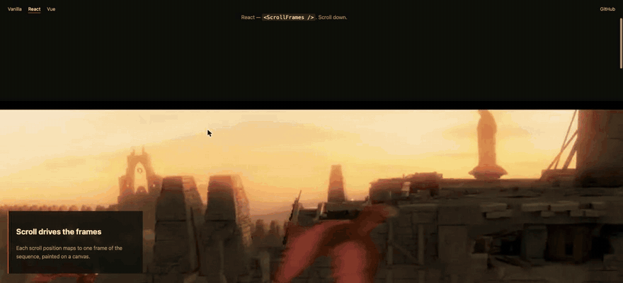

# scrollframes

Scroll-scrubbed image sequences — the "video that plays as you scroll" effect — painted on a `<canvas>`.
Framework-agnostic core, React and Vue 3 components, and a Python converter that turns any video into frames.

[](https://www.npmjs.com/package/scrollframes)
[](./LICENSE)

**[Live demo →](https://ajuarez93.github.io/scrollframes/)** · [Vanilla](https://ajuarez93.github.io/scrollframes/index.html) · [React](https://ajuarez93.github.io/scrollframes/react.html) · [Vue](https://ajuarez93.github.io/scrollframes/vue.html)



## Why frames and not a `<video>`?

Setting `video.currentTime` on scroll stutters: browsers seek to the nearest keyframe and decode forward.
scrollframes pre-decodes every frame as an image and paints the one that matches the scroll position, so
scrubbing is instant in both directions.

- **Canvas rendering** with `cover` / `contain` fit, HiDPI support and `ImageBitmap` decoding
- **Lazy by default** — nothing downloads until the player is about one viewport away
- **Responsive sources** — the converter encodes several widths; each device downloads only the one that fits
- **Coarse-to-fine preload** — the frame on screen first, then every 16th, 8th… frame, so scrubbing anywhere shows a nearby frame long before the whole set arrives
- **Optional smoothing** — the playhead eases towards the scroll position (`smoothing={0.8}`)
- **Scroll-linked overlays** — `onProgress`, React `renderOverlay`, Vue scoped `#overlay` slot
- **`poster`** image until the first frame paints
- **`prefers-reduced-motion`** — shows a single still frame and skips downloading the rest
- **SSR-safe** — nothing touches `window` until mount
- **`position: sticky` layout**, so it works under transformed ancestors (no `position: fixed` traps)
- **~3.5 KB** gzipped core, zero dependencies

## Install

```bash
npm install scrollframes
```

## 1. Convert your video

The converter lives in [`converter/`](./converter) (also shipped inside the npm package).

```bash
pip install -r converter/requirements.txt          # opencv-python-headless (+ pillow>=11.3 for AVIF)
python converter/scrollframes_convert.py hero.mp4 -o public/hero
# 168 frames -> public/hero (1.9 MB)

# Recommended for production: responsive AVIF variants
python converter/scrollframes_convert.py hero.mp4 -o public/hero --widths 640,1280,1920 --format avif
```

This writes `public/hero/frame_0001.webp …` plus a `manifest.json`. With `--widths`, each width gets its
own folder and the manifest lists them as variants; the player picks the smallest one that covers the canvas.

| Flag | Default | |
|---|---|---|
| `--format webp\|jpg\|avif` | `webp` | image format (`avif` needs Pillow ≥ 11.3) |
| `--quality N` | `75` | encoder quality (1–100) |
| `--width N` | source | resize, keeping aspect ratio |
| `--widths A,B,C` | — | responsive variants, one folder per width (video decoded once) |
| `--step N` | `1` | keep every Nth frame (fewer frames = lighter page) |
| `--start N` / `--end N` | whole video | frame range to keep |
| `--json` | off | write one JSON file of base64 JPEGs (`[{ id, img }]`) instead of a folder |

Rule of thumb: 120–200 frames at 960–1600px wide is plenty for a full-screen hero.

## 2a. As a component — React

```jsx
import { ScrollFrames } from 'scrollframes/react'

export function Hero() {
  return (
    <ScrollFrames
      manifest="/hero/manifest.json"
      poster="/hero/poster.jpg"
      height="400vh"
      smoothing={0.8}
      overlay={<h1 className="title">Hello</h1>}
      renderOverlay={({ progress }) => <div className="bar" style={{ transform: `scaleX(${progress})` }} />}
    >
      {/* optional: content that scrolls over the pinned frames */}
      <section style={{ height: '100vh' }}>Chapter one</section>
    </ScrollFrames>
  )
}
```

There is also a `useScrollFrames(containerRef, canvasRef, source, options)` hook for fully custom markup.

## 2b. As a component — Vue 3

```vue
<script setup>
import { ScrollFrames } from 'scrollframes/vue'
</script>

<template>
  <ScrollFrames manifest="/hero/manifest.json" height="400vh" :smoothing="0.8" @frame="(i) => console.log(i)">
    <template #overlay="{ progress }">
      <h1 class="title" :style="{ opacity: 1 - progress }">Hello</h1>
    </template>
    <section style="height: 100vh">Chapter one</section>
  </ScrollFrames>
</template>
```

## 2c. As a library — any framework or none

```js
import { createScrollFrames } from 'scrollframes'

const player = createScrollFrames({
  container: document.querySelector('#hero'),   // tall element that scrolls
  canvas: document.querySelector('#hero canvas'), // usually inside a sticky child
  source: { manifest: '/hero/manifest.json' },
  onFrame: (index, progress) => {},
})

// later
player.destroy()
```

```html
<section id="hero" style="position: relative; height: 400vh">
  <div style="position: sticky; top: 0; height: 100vh">
    <canvas style="width: 100%; height: 100%; display: block"></canvas>
  </div>
</section>
```

## Options

Component props and `createScrollFrames` options share the same names.

| Option | Type | Default | |
|---|---|---|---|
| `manifest` / `frames` / `base64Json` | `string` / `string[]` / `string` | — | frame source (one of them). In the core API: `source: { manifest }` etc. |
| `fit` | `'cover' \| 'contain'` | `'cover'` | how a frame fills the canvas |
| `range` | `[start, end]` | `[0, 1]` | part of the scroll that plays the sequence |
| `height` | CSS length / px | `'300vh'` | total scroll length (components only) |
| `pxPerFrame` | `number` | — | scroll length per frame; overrides `height` (components only) |
| `preload` | `'visible' \| 'eager'` | `'visible'` | start downloading near the viewport, or right away |
| `preloadMargin` | CSS margin | `'100% 0px'` | how far ahead `'visible'` starts |
| `poster` | URL | — | image shown until the first frame paints |
| `smoothing` | `0–1` | `0` | easing of the playhead towards the scroll position |
| `concurrency` | `number` | `6` | parallel image requests while preloading |
| `respectReducedMotion` | `boolean` | `true` | still frame when the user prefers reduced motion |
| `reducedMotionFrame` | `number` | `0` | which frame to show in that case |
| `onReady` / `onLoadProgress` / `onFrame` / `onProgress` / `onError` | callbacks | — | in Vue: `@ready`, `@load-progress`, `@frame`, `@progress`, `@error` |
| `renderOverlay` | `({ progress, frame }) => node` | — | React only; Vue uses the scoped `#overlay` slot |

Instance: `setProgress(0..1)`, `refresh()`, `destroy()`, plus `frameCount`, `currentFrame` and `progress`.
Helpers: `getScrollProgress(el)`, `progressToFrame(progress, count, range)`, `pickVariant(variants, width)`,
`loadOrder(count, first)`, `resolveFrameUrls(source, targetWidth)`.

## Development

```bash
npm install
npm run demo        # Vite dev server with the three demos
npm test            # vitest
npm run build       # dist/ (ESM + CJS + types)
```

## Credits

Demo footage: [Sintel](https://durian.blender.org/) trailer (0:24–0:31), © Blender Foundation, licensed
[CC BY 3.0](https://creativecommons.org/licenses/by/3.0/). The footage is only used by the demo and is not part of the npm package.

## License

MIT © [Jose Alfonso Guerrero Juarez](https://www.ajuarez93.com)
